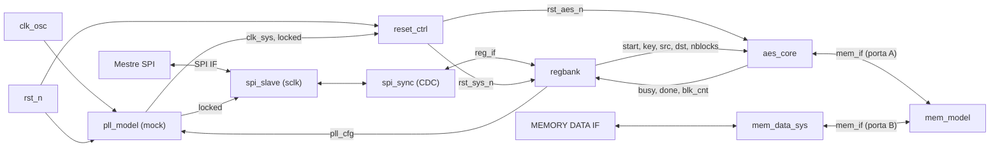
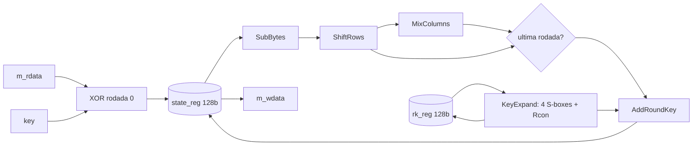
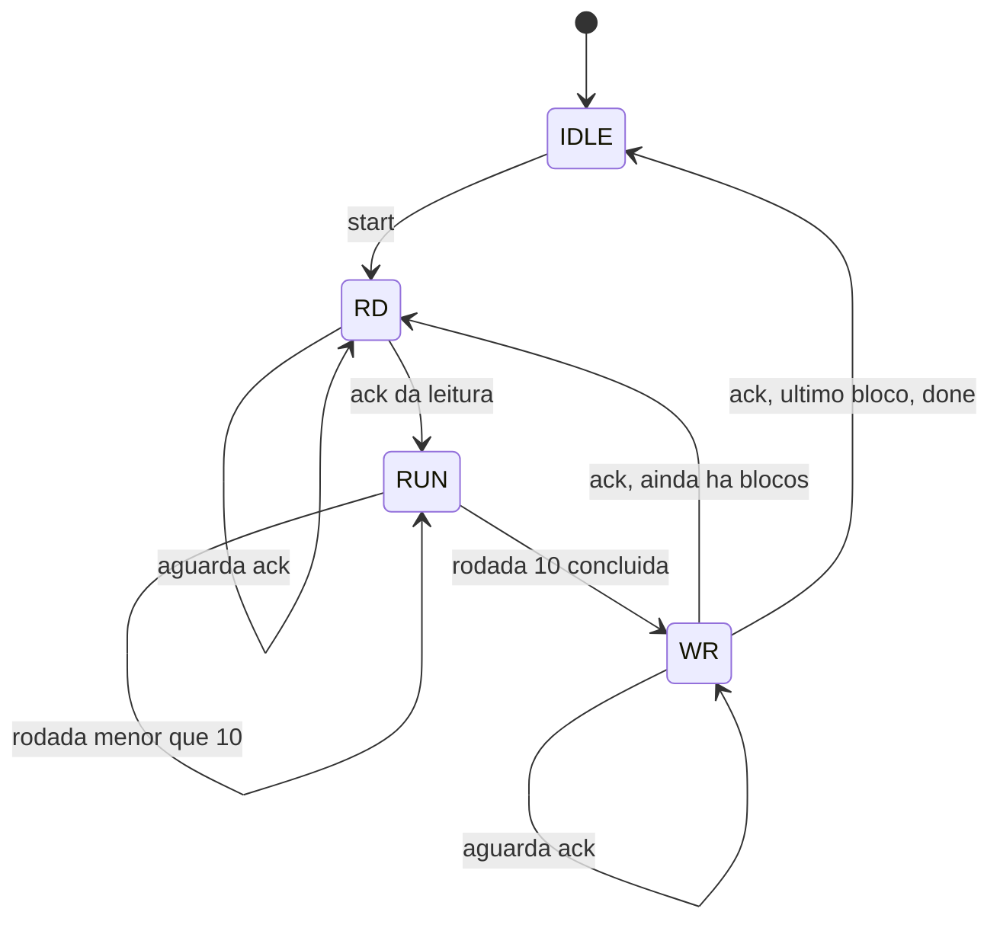

# Documento de Arquitetura v1.0 — AES Top-Level System

**Semana 2 · versão 1.0 (para defesa)** · Projeto Hands-on, trilha RTL Design

Este documento define a arquitetura e a microarquitetura do sistema de topo (RESET, PLL,
SPI, banco de registradores, núcleo AES, MEMORY/DATA System e memória), a partir da
arquitetura-base comum às trilhas de RTL e de verificação.

Parte da especificação do sistema de topo e do RTL de referência da verificação ainda não
está disponível. Cada ponto dependente delas virou uma **premissa numerada (A1–A10)** na
seção 1. As premissas são o que a defesa e o alinhamento com o verificador parceiro devem
confirmar ou corrigir.

Documentos de apoio: [`mapa_de_registradores.md`](mapa_de_registradores.md) e
[`interfaces_modelos.md`](interfaces_modelos.md) (modelos do PLL e da memória).

---

## 1. Escopo e premissas

| # | Premissa adotada | Base | Se mudar, o que muda |
| --- | --- | --- | --- |
| A1 | A **chave** entra por registradores (via SPI); os **blocos de dados** são lidos e escritos pelo núcleo AES na memória. A MEMORY DATA IF externa carrega os blocos de entrada e lê os de saída | Diagrama (SPI ↔ AES por controle e status; AES ↔ memória) | Muda a interface do núcleo e os registradores `SRC_ADDR`, `DST_ADDR` e `NBLOCKS` |
| A2 | Memória **dual-port**, palavra de **128 bits**, endereço de `ADDR_W = 10` bits (parâmetro). Porta A do núcleo AES, porta B do MEMORY/DATA System. O acesso externo não ocorre durante a operação do AES | Diagrama (duas ligações na memória) | Largura e profundidade são parâmetros; a regra de não simultaneidade vira requisito de software |
| A3 | **AES-128, somente cifragem, modo ECB** (cada bloco é cifrado de forma independente) | Especificação funcional ainda não recebida | Decifragem, outros tamanhos de chave ou outro modo alteram o datapath e o controle |
| A4 | SPI no **modo 0** (CPOL=0, CPHA=0), MSB primeiro, quadro de 40 bits (escrita) ou 48 bits (leitura). Sinais `sclk`, `cs_n`, `mosi`, `miso` | Não especificado | Muda o `spi_slave` e os nomes de porta |
| A5 | Modelo do PLL: `clk_out` **contínuo** na configuração padrão; `locked` sobe `LOCK_CYCLES` ciclos de `clk_osc` depois do reset; reconfigurar derruba `locked` e a frequência muda quando ele volta | Descrição da Semana 2 ("sai do reset com configuração padrão e trava sozinho") | Ajuste no `reset_ctrl` e nos modelos |
| A6 | Reset global externo **assíncrono, ativo em nível baixo**; o mestre mantém `cs_n` alto durante o reset | Convenção | Inversão de polaridade; análise de reset no domínio do SPI |
| A7 | A MEMORY DATA IF usa o protocolo `req/we/addr/wdata/rdata/ack` e é síncrona a `clk_sys`. **O clock que acompanha a interface precisa ser confirmado** | Não especificado | Muda o `mem_data_sys` e a travessia de domínio, se a interface for de outro clock |
| A8 | Restrição adotada: `f_sys ≥ 4 × f_sclk`. Frequências alvo a definir | Restrição conservadora | Validar na CDC (Semana 6) e no SDC (Semana 7) |
| A9 | Nomes de portas, protocolos e temporizações de topo serão **ajustados ao RTL de referência da verificação** | Documento do projeto | Renomeação nas interfaces de topo e nos modelos |
| A10 | A memória não tem sinal de erro; `NBLOCKS ≥ 1` | Simplificação | Inclusão de status de erro de memória |

---

## 2. Visão geral do sistema

| Bloco | Domínio de clock | Função |
| --- | --- | --- |
| `pll_model` | `clk_osc` → `clk_sys` | Modelo comportamental do PLL (fora do RTL sintetizável): gera `clk_sys` e `locked` |
| `reset_ctrl` | `clk_sys` | Libera o reset do sistema depois do primeiro `locked` e cria o reset do núcleo AES |
| `spi_slave` | `sclk` | Registrador de deslocamento, contador de bits e `miso` |
| `spi_sync` | `sclk` ↔ `clk_sys` | Travessia de domínio de clock; entrega requisições ao `reg_if` |
| `regbank` | `clk_sys` | Registradores de configuração, controle e status, incluindo a configuração do PLL |
| `aes_core` | `clk_sys` | Cifragem AES-128; mestre de memória (porta A) |
| `mem_data_sys` | `clk_sys` | Ponte entre a MEMORY DATA IF externa e a porta B da memória |
| `mem_model` | `clk_sys` | Modelo comportamental da memória (fora do RTL sintetizável) |

---

## 3. Interfaces de topo

Os nomes abaixo seguem a premissa A9: serão ajustados ao RTL de referência e à
especificação do sistema de topo.

### 3.1 GLOBAL RESET

| Sinal | Direção | Largura | Descrição |
| --- | --- | --- | --- |
| `rst_n` | entrada | 1 | Reset global, assíncrono, ativo baixo (A6). Reinicia o PLL e o `reset_ctrl` |

### 3.2 clk from OSC

| Sinal | Direção | Largura | Descrição |
| --- | --- | --- | --- |
| `clk_osc` | entrada | 1 | Clock do oscilador. Alimenta apenas o PLL |

### 3.3 SPI IF

| Sinal | Direção | Largura | Descrição |
| --- | --- | --- | --- |
| `sclk` | entrada | 1 | Clock SPI, gerado pelo mestre |
| `cs_n` | entrada | 1 | Chip select, ativo baixo |
| `mosi` | entrada | 1 | Dado do mestre para o escravo |
| `miso` | saída | 1 | Dado do escravo para o mestre. Sem tri-state na v1.0 |

### 3.4 MEMORY DATA IF (A7)

| Sinal | Direção | Largura | Descrição |
| --- | --- | --- | --- |
| `mdi_req` | entrada | 1 | Requisição de acesso, mantida até `mdi_ack` |
| `mdi_we` | entrada | 1 | 1 = escrita, 0 = leitura |
| `mdi_addr` | entrada | `ADDR_W` | Endereço do bloco de 128 bits |
| `mdi_wdata` | entrada | 128 | Dado de escrita |
| `mdi_rdata` | saída | 128 | Dado de leitura, válido no ciclo de `mdi_ack` |
| `mdi_ack` | saída | 1 | Pulso de um ciclo: acesso concluído |

---

## 4. Interfaces internas

### 4.1 `reg_if` (entre `spi_sync` e `regbank`)

| Sinal | Direção (vista do `regbank`) | Largura | Descrição |
| --- | --- | --- | --- |
| `req` | entrada | 1 | Pulso de um ciclo: requisição válida |
| `we` | entrada | 1 | 1 = escrita, 0 = leitura |
| `addr` | entrada | 7 | Endereço do registrador, em palavras de 32 bits |
| `wdata` | entrada | 32 | Dado de escrita |
| `rdata` | saída | 32 | Dado de leitura |
| `rvalid` | saída | 1 | Pulso de um ciclo, no ciclo seguinte a uma leitura |

### 4.2 `mem_if` (núcleo AES ↔ memória, e `mem_data_sys` ↔ memória)

| Sinal | Direção (vista do mestre) | Largura | Descrição |
| --- | --- | --- | --- |
| `req` | saída | 1 | Requisição, mantida até `ack` |
| `we` | saída | 1 | 1 = escrita, 0 = leitura |
| `addr` | saída | `ADDR_W` | Endereço do bloco de 128 bits |
| `wdata` | saída | 128 | Dado de escrita |
| `rdata` | entrada | 128 | Dado de leitura, válido no ciclo de `ack` |
| `ack` | entrada | 1 | Pulso de um ciclo: acesso concluído |

Regras: o mestre mantém `req`, `we`, `addr` e `wdata` até amostrar `ack=1`. A escrita é
efetivada na borda em que `ack=1` é amostrado. O acesso termina `LATENCY` ciclos
(`LATENCY ≥ 1`) depois da primeira borda com `req=1`. O mestre baixa `req` no ciclo
seguinte ao `ack`.

### 4.3 Interface do núcleo AES (`aes_core`)

| Grupo | Sinal | Direção | Largura | Descrição |
| --- | --- | --- | --- | --- |
| Clock e reset | `clk` | entrada | 1 | `clk_sys` |
| | `rst_n` | entrada | 1 | `rst_aes_n` |
| Controle | `start` | entrada | 1 | Pulso: inicia a operação |
| | `clr` | entrada | 1 | Pulso: aborta e volta ao estado ocioso, sem gerar `done` |
| | `key` | entrada | 128 | Chave. `key[127:120]` é o primeiro byte. **Estável enquanto `busy=1`** |
| | `src_addr` | entrada | `ADDR_W` | Endereço do primeiro bloco de entrada |
| | `dst_addr` | entrada | `ADDR_W` | Endereço do primeiro bloco de saída |
| | `nblocks` | entrada | 16 | Número de blocos de 128 bits (≥ 1) |
| Status | `busy` | saída | 1 | 1 enquanto há operação em andamento |
| | `done` | saída | 1 | Pulso de um ciclo ao concluir todos os blocos |
| | `blk_cnt` | saída | 16 | Blocos concluídos na operação atual ou na última |
| Memória | `m_req`, `m_we`, `m_addr`, `m_wdata`, `m_rdata`, `m_ack` | — | — | `mem_if` (seção 4.2), porta A |

Regras de uso:

1. `src_addr`, `dst_addr` e `nblocks` são amostrados na borda em que `start=1` e `busy=0`.
2. O `regbank` garante que `key`, `src_addr`, `dst_addr` e `nblocks` não mudam enquanto
   `busy=1` (escritas são ignoradas, ver mapa de registradores).
3. Ordem dos bytes: a chave `2b7e151628aed2a6abf7158809cf4f3c`, como escrita no FIPS-197,
   corresponde a `key = 128'h2b7e1516_28aed2a6_abf71588_09cf4f3c`. O mesmo vale para as
   palavras de 128 bits na memória (`wdata[127:120]` é o primeiro byte do bloco).
4. O bloco `i` é lido de `src_addr + i` e escrito em `dst_addr + i`. Operação no mesmo
   endereço (`src_addr = dst_addr`) é permitida.

### 4.4 Modelos do PLL e da memória

As interfaces dos modelos comportamentais (nome do módulo, portas, larguras e significado
dos bits de configuração) estão em [`interfaces_modelos.md`](interfaces_modelos.md).

---

## 5. Clock e reset

### 5.1 Domínios

| Domínio | Origem | Blocos |
| --- | --- | --- |
| `clk_osc` | Oscilador externo | Apenas a entrada do `pll_model` |
| `clk_sys` | Saída do `pll_model` | `reset_ctrl`, lado do sistema do `spi_sync`, `regbank`, `aes_core`, `mem_data_sys`, `mem_model` |
| `sclk` | Mestre SPI externo | `spi_slave`, lado SPI do `spi_sync` |

### 5.2 Sequência de reset e travamento do PLL

1. `rst_n` baixo: o `pll_model` vai para a configuração padrão (`locked=0`); o `reset_ctrl`
   mantém `rst_sys_n` e `rst_aes_n` baixos.
2. `rst_n` sobe. O PLL trava sozinho e `locked` sobe.
3. O `reset_ctrl` libera `rst_sys_n` de forma **síncrona a `clk_sys`**, depois do
   **primeiro** `locked`. A partir daí o banco de registradores existe e aceita acessos.
4. `rst_aes_n = rst_sys_n & locked` (sincronizado em `clk_sys`): o núcleo AES só opera com o
   PLL travado.
5. Depois do primeiro lock, uma queda de `locked` (por reconfiguração) **não reinicia o
   sistema**, para o `regbank` não perder `PLL_CFG`. Ela apenas reinicia o núcleo AES
   (`rst_aes_n`), o que aborta uma operação em curso.

### 5.3 Reprogramação do PLL

Os bits de configuração ficam no `regbank` (`PLL_CFG`), no domínio do sistema. O `regbank`
só aceita escrita em `PLL_CFG` com `PLL_LOCKED=1` e `BUSY=0`; fora dessas condições a escrita
é ignorada e `STATUS.ERR` é setado. Isso cumpre a regra de reprogramar só depois do `locked`
e evita derrubar o núcleo no meio de uma operação.

### 5.4 Reset e prontidão no domínio `sclk`

- Os registradores do `spi_slave` têm reset assíncrono por `rst_n` e são reiniciados por
  `cs_n` alto (reinício de quadro). A premissa A6 garante `cs_n` alto durante o reset.
- O `locked` entra no `spi_slave` por um sincronizador de 2 flip-flops em `sclk`. Enquanto
  `locked_sclk=0`, o `spi_slave` **descarta escritas e devolve zeros em `miso`**.
- O registrador `ID` tem valor diferente de zero (`0xAE500001`). O mestre pode ler `ID`
  repetidamente até obter esse valor, o que indica sistema pronto. O sincronizador só avança
  com `sclk` ativo, então a primeira leitura depois do lock pode ainda retornar zero; o mestre
  repete a leitura.

---

## 6. Protocolo SPI e travessia de domínio (CDC)

### 6.1 Quadro SPI (A4)

Modo 0: `mosi` é amostrado na borda de subida de `sclk`, `miso` muda na borda de descida,
MSB primeiro, `cs_n` baixo durante todo o quadro.

| Tipo | Sequência | Bits |
| --- | --- | --- |
| Escrita | 1 byte `{W=1, addr[6:0]}` + 4 bytes de dado em `mosi` | 40 |
| Leitura | 1 byte `{R=0, addr[6:0]}` + 1 byte dummy (turnaround) + 4 bytes de dado em `miso` | 48 |

Um quadro interrompido (`cs_n` sobe antes da contagem completa) é **descartado**: nenhuma
escrita acontece. Cada escrita é atômica.

### 6.2 Travessia `sclk` → `clk_sys` (requisição)

1. O `spi_slave` conta bordas de `sclk`. Ao completar o quadro de escrita (40 bits), ou o
   byte de endereço de uma leitura (8 bits), copia `addr` e `wdata` para registradores de
   **hold** e inverte um bit **toggle** (`req_tgl`).
2. O `spi_sync` passa `req_tgl` por um sincronizador de 2 flip-flops em `clk_sys`. Uma
   detecção de transição gera o pulso `req` do `reg_if`.
3. Os registradores de hold só são sobrescritos quando o quadro seguinte completa o byte de
   endereço, ou seja, pelo menos 8 períodos de `sclk` depois. Com `f_sys ≥ 4 × f_sclk` (A8)
   isso equivale a pelo menos 32 ciclos de `clk_sys`, muito mais que o necessário para
   amostrar a requisição. Os dados multibit estão **estáveis por construção**; nenhum dado
   multibit passa por sincronizador.

### 6.3 Travessia `clk_sys` → `sclk` (resposta de leitura)

1. O `regbank` responde com `rdata` e `rvalid`. O `spi_sync` guarda `rdata` num registrador
   de hold e inverte `rsp_tgl`.
2. `rsp_tgl` passa por um sincronizador de 2 flip-flops em `sclk`. O `spi_slave` carrega o
   registrador de deslocamento de `miso` com o `rdata` capturado e começa a deslocar depois
   do byte dummy.
3. O byte dummy dá 8 períodos de `sclk` para a ida e volta. A restrição A8 será verificada
   na CDC (Semana 6).

O dado lido é um **instantâneo** tomado no momento do endereço, o que mantém a leitura de 32
bits coerente.

---

## 7. Núcleo AES: microarquitetura

### 7.1 Alternativas avaliadas

| Alternativa | Latência de cifragem | S-boxes (dados + chave) | Caminho crítico | Avaliação |
| --- | --- | --- | --- | --- |
| Totalmente desenrolada (10 rodadas combinacionais) | 1 ciclo | 160 + 40 | Muito longo | Descartada: área desproporcional |
| **Iterativa, 1 rodada por ciclo, datapath de 128 bits** | **10 ciclos** | **16 + 4** | **Uma rodada** | **Escolhida** |
| Datapath de 32 bits (1 coluna por ciclo) | ≈ 40 ciclos | 4 + 4 | Curto | Documentada como alternativa de área |
| Serial de 8 bits | ≈ 160 ciclos | 1 a 2 | Mínimo | Descartada: controle complexo sem ganho necessário |

### 7.2 Justificativa da escolha

1. **Conferência direta com o padrão.** Com uma rodada por ciclo, o registrador de estado
   após cada borda corresponde aos valores intermediários por rodada do Apêndice C.1 do
   FIPS-197 (`start`, `s_box`, `s_row`, `m_col`, `k_sch`). Isso simplifica os testes
   unitários da Semana 3 e o testbench da Semana 4.
2. **A cifragem não é o gargalo.** Cada bloco exige acesso de leitura e de escrita à
   memória, e a configuração por SPI custa centenas de períodos de `sclk`. O núcleo fica
   ocioso na maior parte do tempo, o que favorece clock gating e power gating nas fases
   posteriores.
3. **Risco de área.** Se a síntese baseline (Semana 7) mostrar que a área do datapath de 128
   bits é excessiva, o datapath de 32 bits é o plano B. A interface do núcleo (seção 4.3)
   não muda.

### 7.3 Datapath

- **S-box:** tabela combinacional de 256 entradas. São 20 instâncias: 16 no `SubBytes` e 4
  no `SubWord` da expansão de chave. Variantes de menor área ficam para a Semana 7.
- **Expansão de chave on-the-fly:** a chave da rodada seguinte é calculada a cada ciclo a
  partir de `rk_reg`. No início de cada bloco, `rk_reg` recebe `key`, que permanece estável
  durante a operação. `Rcon` por rodada: `01, 02, 04, 08, 10, 20, 40, 80, 1b, 36`.
- **Última rodada:** não há `MixColumns` (o multiplexador `BYP` o contorna).

### 7.4 Controle

Para cada bloco `i`:

| Passo | Ação |
| --- | --- |
| `RD` | `m_req=1`, `m_we=0`, `m_addr = src_addr + i`, mantidos até `m_ack` |
| Borda do `ack` da leitura (E0) | `state ← m_rdata XOR key`, `rk ← key`, contador de rodada ← 1 |
| E1 a E9 | Rodada completa: `rk ← KeyExpand(rk)`, `state ← MixColumns(ShiftRows(SubBytes(state))) XOR rk` |
| E10 | Rodada final (sem `MixColumns`) |
| `WR` | `m_req=1`, `m_we=1`, `m_addr = dst_addr + i`, `m_wdata = state`, mantidos até `m_ack` |
| Borda do `ack` da escrita | `blk_cnt ← blk_cnt + 1`. Se foi o último bloco: `done` por um ciclo e `busy ← 0` |

`busy` fica alto de `start` até o `ack` da última escrita.

---

## 8. Banco de registradores

Resumo (o mapa completo, com campos, reset e semântica de acesso, está em
[`mapa_de_registradores.md`](mapa_de_registradores.md)):

| Endereço | Registrador | Acesso |
| --- | --- | --- |
| `0x00` | `ID` | RO |
| `0x01` | `CTRL` | W1P (pulso) |
| `0x02` | `STATUS` | RO |
| `0x03` | `PLL_CFG` | RW |
| `0x04` a `0x07` | `KEY0` a `KEY3` | WO |
| `0x08` | `SRC_ADDR` | RW |
| `0x09` | `DST_ADDR` | RW |
| `0x0A` | `NBLOCKS` | RW |
| `0x0B` | `BLK_CNT` | RO |

---

## 9. Preparação para baixo consumo (prévia, a fechar na Semana 10)

| Domínio candidato | Blocos | Observação |
| --- | --- | --- |
| Sempre ligado | `reset_ctrl`, `pll_model`, `spi_slave`, `spi_sync` | Exigência do documento do projeto (RESET, PLL e SPI) |
| Sempre ligado (proposta) | `regbank` | Mantém `KEY`, endereços, `NBLOCKS` e `PLL_CFG` |
| A definir | `mem_data_sys`, `mem_model` | Dependem do papel da memória no sistema |
| Chaveável | `aes_core` | Só é desligado com `BUSY=0`; todo o contexto está no `regbank` |

Como o núcleo só é desligado ocioso e o `regbank` guarda tudo de que ele precisa, o
`aes_core` pode ser desligado **sem registradores de retenção**. Clock gating do núcleo tem
uma condição de habilitação simples (`start` ou `busy`). A definição final (modos, tabela
de estados, sequências) fica para a Semana 10.

---

## 10. Verificação e compatibilidade

- **Vetores do FIPS-197.** Apêndice B: chave `2b7e1516 28aed2a6 abf71588 09cf4f3c`, texto
  `3243f6a8 885a308d 313198a2 e0370734`, cifrado `3925841d 02dc09fb dc118597 196a0b32`.
  Apêndice C.1: chave `00010203 04050607 08090a0b 0c0d0e0f`, texto
  `00112233 44556677 8899aabb ccddeeff`, cifrado `69c4e0d8 6a7b0430 d8cdb780 70b4c55a`.
  O Apêndice C.1 também lista `start`, `s_box`, `s_row`, `m_col` e `k_sch` de cada rodada,
  para os testes unitários da Semana 3.
- **Teste de ponta a ponta (Semana 6):** configuração via SPI, entrada pela MEMORY DATA IF,
  AES, saída pela MEMORY DATA IF.
- **Compatibilidade com a trilha de verificação.** As interfaces de topo e as dos modelos
  devem coincidir com as do RTL de referência (nomes, protocolos, temporizações). Os modelos
  do PLL e da memória ficam em `models/`, fora do RTL sintetizável, e serão tratados como
  caixas-pretas na síntese (Semana 7) e no Formality (Semana 8).
- **Equivalência (Semanas 8 e 9):** RTL como referência, netlist como implementação, com o
  arquivo SVF gerado pela síntese.

---

## 11. Plano de módulos

| Semana | Módulos |
| --- | --- |
| 3 | `aes_sbox`, `aes_subbytes`, `aes_shiftrows`, `aes_mixcolumns` e testes unitários |
| 4 | `aes_keyexp`, `aes_core` (FSM, registradores e porta de memória); testbench com uma memória simples |
| 5 | `spi_slave`, `spi_sync`, `regbank`, `reset_ctrl`, `pll_model` (em `models/`) |
| 6 | `mem_data_sys`, `mem_model` (em `models/`), `aes_top`, integração e CDC |

---

## 12. Registro de decisões

| # | Decisão | Alternativas descartadas | Motivo |
| --- | --- | --- | --- |
| D1 | AES-128, cifragem, ECB (A3) | Decifragem, 192 e 256 bits, outros modos | Escopo ainda não confirmado; o núcleo pode ser estendido |
| D2 | Iterativa, 1 rodada por ciclo, 128 bits | Desenrolada, 32 bits, 8 bits | Conferência com o FIPS-197; núcleo ocioso favorece o baixo consumo |
| D3 | Expansão de chave on-the-fly; `key` estável durante `busy` | 11 chaves pré-calculadas; cópia local da chave | Menos armazenamento; o `regbank` já protege os registradores |
| D4 | S-box por tabela combinacional | Campo composto | Simplicidade; reavaliar com a síntese |
| D5 | Chave por registradores, dados pela memória (A1) | Dados por registradores | Diagrama e descrição da Semana 2 |
| D6 | Memória dual-port de 128 bits (A2) | Porta única com arbitragem | Dispensa arbitragem; o acesso externo ocorre fora da operação |
| D7 | SPI modo 0 com byte dummy na leitura (A4) | Outros modos, leitura sem dummy | Dá folga à travessia de domínio |
| D8 | CDC por toggle e hold, sem dado multibit sincronizado | FIFO assíncrona | Dados estáticos por construção; menor área |
| D9 | `rst_sys_n` liberado no primeiro `locked`; `locked` só reinicia o núcleo | `locked` reiniciando tudo | O `regbank` não pode perder `PLL_CFG` ao reconfigurar |
| D10 | `PLL_CFG` só com `PLL_LOCKED=1` e `BUSY=0` | Escrita livre | Cumpre "só depois do locked" e protege a operação |
| D11 | `spi_slave` descarta escritas e devolve zeros sem `locked`; `ID` indica prontidão | Sem proteção | O mestre sabe quando o sistema está pronto |
| D12 | `KEY` somente escrita | Chave legível | Evita expor a chave pela interface |
| D13 | `aes_core` desligável sem retenção, só ocioso | Retenção de estado | Contexto no `regbank` |

---

## 13. Pendências para a defesa e para o alinhamento

- [ ] Obter a **especificação do sistema de topo** (SPI IF e MEMORY DATA IF) e ajustar a seção 3.
- [ ] Confirmar o **clock da MEMORY DATA IF** (A7): ela é síncrona a `clk_sys`, que é um
      clock interno? Se for de outro clock, o `mem_data_sys` precisa de travessia de domínio.
- [ ] Obter o **RTL de referência** e as interfaces dos modelos da verificação (A9).
- [ ] Confirmar com o verificador parceiro os parâmetros dos modelos (`ADDR_W`, `LATENCY`,
      `LOCK_CYCLES`, significado de `cfg`).
- [ ] Confirmar escopo do AES: cifragem apenas, ECB, 128 bits (A3).
- [ ] Definir frequências alvo de `clk_sys` e `sclk` (A8).
