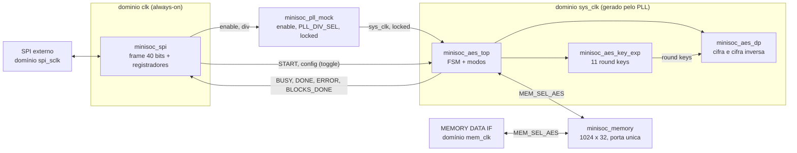
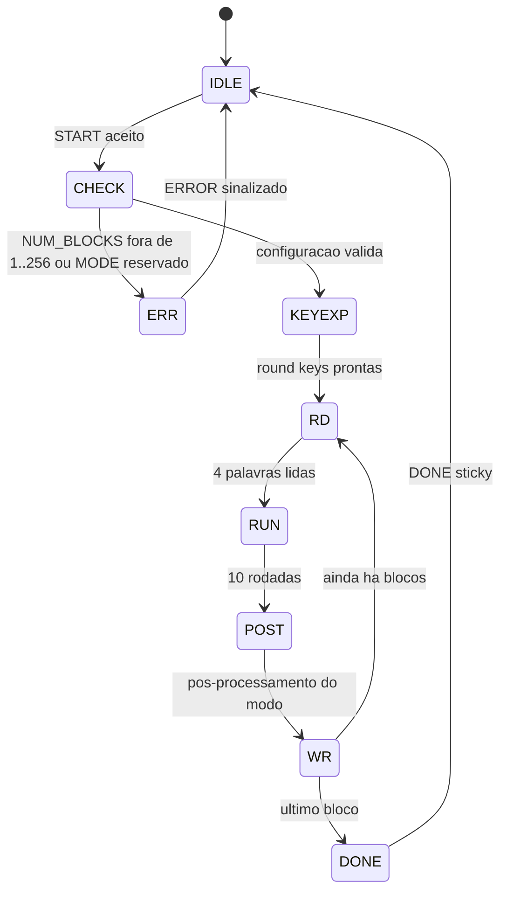

## 1. Visão geral

O `minisoc_top` conecta quatro blocos e expõe as interfaces CLK, RESET, SPI e MEMORY DATA (seção 3 do Block Guide).

| Domínio | Origem | Blocos |
| --- | --- | --- |
| `clk` | Entrada de clock do sistema, sempre ligada | Banco de registradores e lado de `clk` do `minisoc_spi` |
| `sys_clk` | Saída do `minisoc_pll_mock` | `minisoc_aes_top`, `minisoc_aes_dp`, `minisoc_aes_key_exp` |
| `spi_sclk` | Mestre SPI externo | Recepção serial (registrador de deslocamento, contador de bits, MISO) |
| `mem_clk` | Interface MEMORY DATA | Acesso externo à memória, quando a memória pertence à interface |

---

## 2. Microarquitetura do AES

### 2.1 Escolha: iterativa, uma rodada por ciclo

Um único hardware de rodada é reaproveitado nas 10 rodadas, com estado e chave de rodada de 128 bits.

| Alternativa | Latência por bloco | S-boxes | Avaliação |
| --- | --- | --- | --- |
| Desenrolada (10 rodadas combinacionais) | 1 ciclo | muitas | Descartada: área desproporcional e caminho crítico longo |
| **Iterativa, 1 rodada por ciclo, 128 bits** | **≈ 11 ciclos** | **16** (+ 4 na chave) | **Escolhida** |
| Datapath de 32 bits | ≈ 40 ciclos | 4 | Plano B, se a síntese (Semana 8) mostrar área excessiva |

Motivos: (1) o estado após cada borda coincide com os valores por rodada dos Apêndices B e C.1 do FIPS-197, o que
simplifica o teste; (2) a memória de 32 bits e o SPI são mais lentos que o cálculo, então a latência do núcleo não é
o gargalo; (3) a interface externa do `minisoc_aes_dp` (start/done) não muda se a microarquitetura interna mudar.

### 2.2 Reuso dos módulos das Semanas 2 e 3

| Sentido | Passos de uma rodada | Módulos |
| --- | --- | --- |
| Cifra, rodadas 1 a 9 | SubBytes, ShiftRows, MixColumns, AddRoundKey | `minisoc_aes_sub_bytes`, `minisoc_aes_shift_rows`, `minisoc_aes_mix_columns`, `minisoc_aes_add_round_key` |
| Cifra, rodada 10 | SubBytes, ShiftRows, AddRoundKey | os mesmos, sem MixColumns |
| Decifra, rodadas 1 a 9 | InvShiftRows, InvSubBytes, AddRoundKey, InvMixColumns | `minisoc_aes_inv_shift_rows`, `minisoc_aes_inv_sub_bytes`, `minisoc_aes_add_round_key`, `minisoc_aes_inv_mix_columns` |
| Decifra, rodada 10 | InvShiftRows, InvSubBytes, AddRoundKey | os mesmos, sem InvMixColumns |

Na decifra é usada a **cifra inversa direta** (FIPS-197, Figura 12), e não a "equivalente". Assim os mesmos módulos
validados na Semana 3 são usados sem alteração, e as chaves de rodada são consumidas em ordem inversa (da 10 à 0).
O testbench da Semana 3 já demonstra as duas cadeias completas (cifra do Apêndice B e decifra do C.1).

### 2.3 Expansão de chave: decisão tentativa para a Semana 4

| Opção | Vantagem | Custo |
| --- | --- | --- |
| **Pré-computada**: calcular as 11 chaves uma vez e guardá-las | A decifra lê as chaves em ordem inversa sem esforço; o custo da expansão é dividido entre todos os blocos de um START (até 256) | 11 × 128 = 1408 bits de armazenamento |
| On-the-fly | Quase sem armazenamento | A decifra precisa da última chave primeiro; a expansão se repete a cada bloco |

**Tentativa:** pré-computada, porque a chave é capturada uma vez por START e usada em até 256 blocos, e porque a decifra
consome as chaves ao contrário. A decisão final, com a área medida, fica para a Semana 4.

---

## 3. FSM do `minisoc_aes_top` (proposta) [confirmar BG §8]

No START válido o engine captura KEY, IV, COUNTER, MODE, DECRYPT e NUM_BLOCKS. Para cada bloco, lê quatro palavras
de 32 bits, processa e escreve o resultado no mesmo lugar (*in-place*).

| Estado | O que faz | Status |
| --- | --- | --- |
| `IDLE` | Espera o START | BUSY = 0 |
| `CHECK` | Valida NUM_BLOCKS (1 a 256) e MODE; captura a configuração | BUSY = 1 |
| `ERR` | Configuração inválida: ERROR = 1 e volta, sem processar | ERROR = 1 |
| `KEYEXP` | Gera as 11 chaves de rodada | |
| `RD` | Lê as 4 palavras do bloco (memória síncrona de porta única) | |
| `RUN` | Pré-processa pelo modo, executa AddRoundKey inicial e as 10 rodadas | |
| `POST` | Pós-processamento do modo (XOR com IV, bloco anterior ou keystream) | |
| `WR` | Escreve as 4 palavras e incrementa BLOCKS_DONE | BLOCKS_DONE |
| `DONE` | Fim: DONE = 1 (sticky até novo START aceito) e BUSY = 0 | DONE = 1 |

Estimativa por bloco (ainda não é especificação): cerca de 5 ciclos de leitura, 11 de cálculo e 5 de escrita.

### 3.1 Modos de operação

| Modo | Cifra | Decifra | Cuidado de implementação |
| --- | --- | --- | --- |
| ECB | $C = E(P)$ | $P = D(C)$ | Nenhum |
| CBC | $C_i = E(P_i \oplus C_{i-1})$, com $C_0$ = IV | $P_i = D(C_i) \oplus C_{i-1}$ | Em decifra *in-place*, guardar o $C_i$ **antes** de sobrescrevê-lo, pois ele é o $C_{i-1}$ do bloco seguinte |
| CTR | $C_i = P_i \oplus E(\text{contador}_i)$ | O mesmo (só usa $E$) | O datapath deve **cifrar** mesmo com DECRYPT = 1; incremento do COUNTER [confirmar BG §8.2] |
| PCBC, CFB, OFB | Semana 10 | Semana 10 | Constam como limitação conhecida da v1.0 |

---

## 4. CDC [confirmar BG §5.3]

Os cruzamentos de domínio previstos no enunciado são `spi_sclk` × `clk`, `clk` × `sys_clk` e `mem_clk` × `sys_clk`.

### 4.1 `spi_sclk` → `clk` (frame completo)

1. A recepção opera no `spi_sclk`: registrador de deslocamento e contador de bits.
2. Ao completar os 40 bits, o dado vai para um registrador de **hold** e um bit **toggle** é invertido.
3. O toggle atravessa um sincronizador de 2 flip-flops em `clk`; uma detecção de transição gera o pulso de
   "frame completo". O dado multibit não passa por sincronizador: está **estável por construção**, pois o hold só é
   reescrito no frame seguinte.
4. Leitura em duas transações: a primeira seleciona o endereço, e o valor lido é guardado num registrador estável; a
   segunda desloca esse valor pelo MISO (endereço NOP `0x3F` na fase de retorno).

### 4.2 `clk` ↔ `sys_clk` (comando e status)

| Sinal | Sentido | Técnica |
| --- | --- | --- |
| START e configuração | `clk` → `sys_clk` | Toggle com sincronizador de 2 flip-flops; a configuração (KEY, IV, COUNTER, MODE, DECRYPT, NUM_BLOCKS) é estática enquanto BUSY = 1 |
| BUSY, DONE, ERROR | `sys_clk` → `clk` | Nível, com sincronizador de 2 flip-flops |
| BLOCKS_DONE | `sys_clk` → `clk` | **Multibit que muda durante a operação**: contador em código Gray, que muda um bit por vez e passa pelo sincronizador sem corrupção |

### 4.3 `mem_clk` × `sys_clk` (troca de dono da memória)

A memória é de porta única e o dono (interface MEMORY DATA ou AES engine) é escolhido por MEM_SEL_AES, que seleciona
endereço, dado, write-enable e clock. A troca só é segura com o engine ocioso. **Ponto de atenção:** a troca de clock da
memória precisa de seleção sem glitch [confirmar BG §7 sobre como o Block Guide trata isso].

---

## 5. Reset do domínio do sistema [confirmar BG §4.2]

Sequência prevista pelo enunciado: o domínio do sistema fica em reset até o clock ser liberado pelo PLL e transcorrerem
ciclos suficientes.

| Passo | Evento |
| --- | --- |
| 1 | RESET ativo: PLL desabilitado, `locked = 0`, `sys_clk` bloqueado; domínio `sys_clk` em reset |
| 2 | RESET solto: o banco de registradores (domínio `clk`) já responde ao SPI |
| 3 | O mestre habilita o PLL e escolhe `PLL_DIV_SEL` (passos 8 e 9 do modelo de programação) |
| 4 | `locked` sobe após um número pseudoaleatório de ciclos de `clk` e `sys_clk` é liberado |
| 5 | O reset de `sys_clk` é solto de forma **síncrona**, depois de N ciclos de `sys_clk` (N [confirmar BG §4.2]) |
| 6 | O `minisoc_aes_top` passa a aceitar START |

Regra de implementação: reset com assert assíncrono e release síncrono em cada domínio (sincronizador de 2 flip-flops).

---

## 6. Hierarquia e plano de módulos

| Semana | Módulos |
| --- | --- |
| 2 e 3 (feitas) | `minisoc_aes_sbox`, `_sub_bytes`, `_shift_rows`, `_mix_columns`, `_add_round_key` e as inversas |
| 4 | `minisoc_aes_key_exp`, `minisoc_aes_dp` |
| 5 | `minisoc_spi` (com banco de registradores), `minisoc_pll_mock` |
| 6 | `minisoc_memory`, `minisoc_aes_top` |
| 7 | `minisoc_top` |

---

## 7. Decisões

| # | Decisão | Alternativa descartada | Motivo |
| --- | --- | --- | --- |
| M1 | Iterativa, 1 rodada por ciclo, 128 bits | Desenrolada; 32 bits | Confere com o FIPS; área razoável; plano B documentado |
| M2 | Cifra inversa direta na decifra | Cifra inversa equivalente | Reusa os módulos já testados; chaves em ordem inversa |
| M3 | Expansão de chave pré-computada (tentativa) | On-the-fly | Chave usada em até 256 blocos; decifra usa chaves ao contrário |
| M4 | CDC por toggle e hold, sem dado multibit sincronizado | FIFO assíncrona | Dados estáveis por construção; menos área |
| M5 | BLOCKS_DONE em código Gray ao cruzar `sys_clk` → `clk` | Sincronizar bit a bit | Multibit que muda em operação |
| M6 | Reset com assert assíncrono e release síncrono | Reset totalmente síncrono | Funciona sem clock presente; evita metaestabilidade |

---
